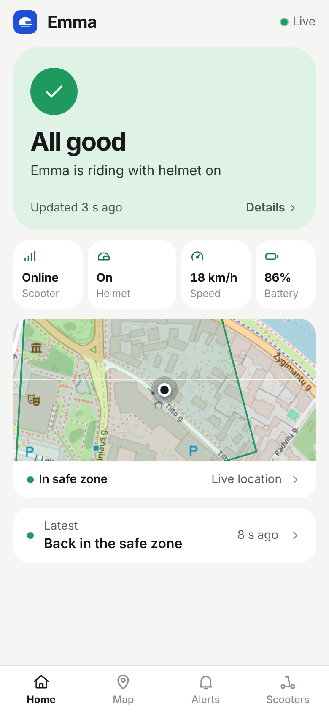
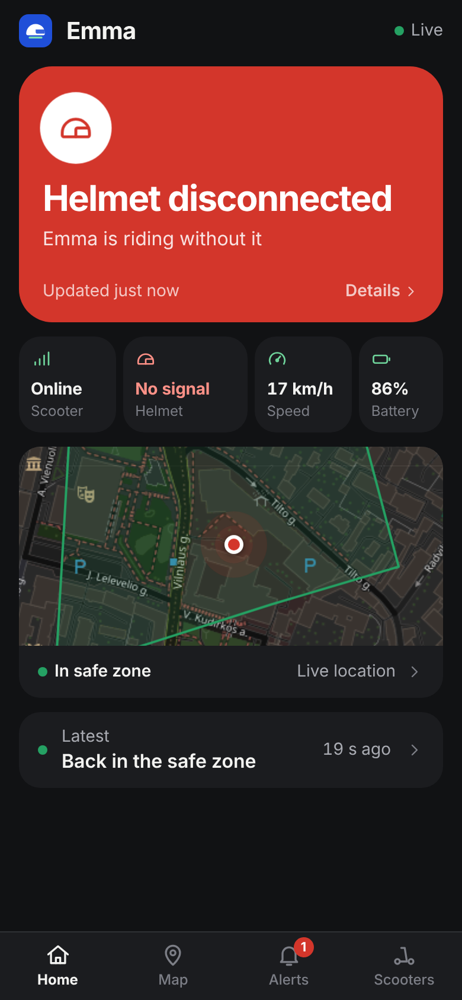
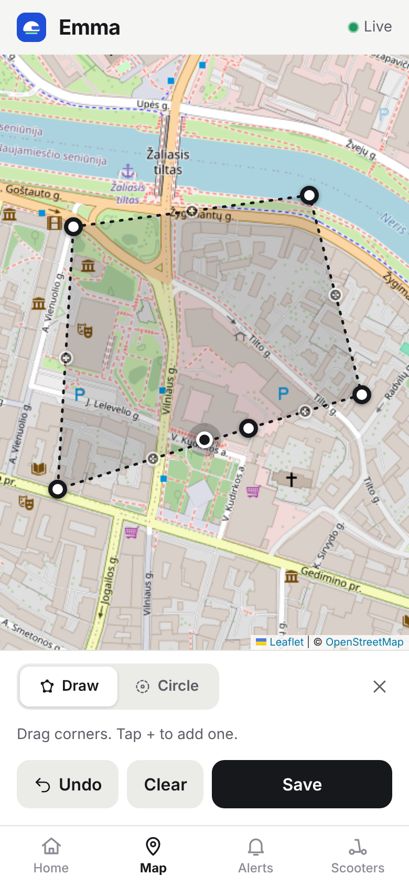
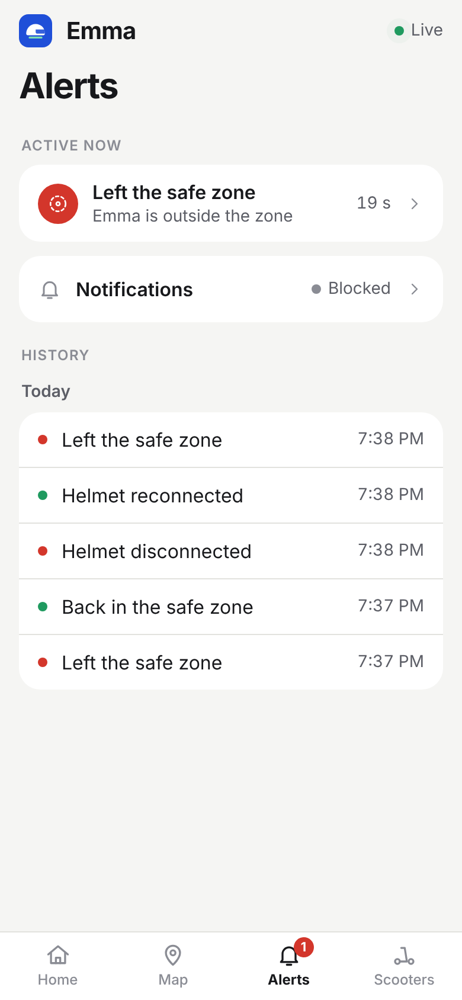

# Helmetto

Child e-scooter safety monitoring. A tag on the helmet, a tag on the scooter and
a parent app: if the kid rides without the helmet, crashes or leaves the safe
zone, the parent gets an alert.

```
helmet (ESP8266) --ESP-NOW heartbeat--> scooter (ESP8266) --HTTPS telemetry every 5 s--> api --SSE--> parent app
                                         scripts/simulate.ts --same HTTP endpoint------^
```

| Folder | What |
|---|---|
| `web/` | Parent app: Vite + React + TypeScript, mobile-first PWA, Leaflet + OpenStreetMap |
| `api/` | Express + TypeScript, SQLite (`node:sqlite`), Server-Sent Events. Also serves the built web app |
| `ai/` | Safety rules as pure, unit-tested functions (transitions, offline timeout, geofence) |
| `shared/` | The contract: TypeScript types, route constants, **[`PROTOCOL.md`](shared/PROTOCOL.md)** |
| `scripts/` | `simulate.ts`: a mock scooter that posts real telemetry |
| `infra/` | [`DEPLOY.md`](infra/DEPLOY.md) (Render / Railway) |

Hardware teammates only need [`shared/PROTOCOL.md`](shared/PROTOCOL.md): one
`POST` with a JSON body and an API key header, with curl and Arduino examples.

## Run locally

Needs Node 22.13 or newer.

```bash
npm install
```

```bash
npm run dev
```

- App: http://localhost:5173 (also on your LAN IP, for a phone on the same WiFi)
- API: http://localhost:3000

No `.env` is needed for local work: the API falls back to device `scooter-001`
with a dev-only key. To choose your own, `cp .env.example .env` and edit it.

In a second terminal, start the mock scooter:

```bash
npm run simulate
```

```bash
npm run simulate -- --scenario helmet-disconnect
```

Scenarios: `normal`, `helmet-disconnect`, `helmet-reconnect`, `helmet-not-worn`,
`crash`, `geofence-exit`, `offline`. While the simulator runs, press `1`–`7` to
switch scenario and `q` to quit. `--minimal` sends only `helmet_connected` with
everything else `null`, like today's hardware. `npm run simulate -- --help`
lists all flags.

### Demo panel in the app

Tap the Helmetto logo five times (or open `/#demo`). It starts the same
simulator inside the server, so it works from a phone with no laptop. Available
when the server runs with `DEMO_MODE=true` (the default locally).

### Other commands

| Command | What |
|---|---|
| `npm test` | Unit tests for `ai/` and integration tests for `api/` |
| `npm run typecheck` | TypeScript check for all packages |
| `npm run build` | Build the web app into `web/dist` |
| `npm start` | Production mode: API + built web app on one port |

## Screens

| All good | Alert | Drawing a zone | Alerts |
|---|---|---|---|
|  |  |  |  |

More in [`docs/screenshots/`](docs/screenshots), in light and dark mode.

Draw a safe zone on the Map tab: **Draw zone**, tap to drop corners, drag a
corner to move it, tap a **+** to add one, then **Save**. **Circle** is the
quick alternative. Set the child's name on the Scooters tab (pencil icon).

## How the safety logic behaves

- The scooter posts telemetry every ~5 s. Fields the hardware can't measure yet
  are `null` and are shown as "Unknown" / "Unavailable", never as readings.
- Alerts fire on **state changes only**: helmet disconnected, helmet not worn,
  crash detected, left the safe zone. Recoveries are logged too.
- No telemetry for 30 s → **scooter offline**. This is a separate state from
  "helmet disconnected": the app then shows helmet status as unknown.
- The safe zone is either a shape drawn on the map (polygon, ray casting) or a
  circle (centre + radius, haversine). It is ignored when GPS is `null`, out of
  range or `0,0`.

## Deploy

One Node service on Render or Railway (not serverless: SSE and SQLite need a
persistent process). Full steps in [`infra/DEPLOY.md`](infra/DEPLOY.md); the
short version for Render is **New → Blueprint → this repo**, which reads
`render.yaml`.

## Known gaps (hackathon scope)

- **No parent login.** Anyone with the app URL can see the scooter and change
  the safe zone. Device telemetry is authenticated; the parent API is not.
- Notifications work in-app and as browser notifications while the app is open.
  There is no web push, so nothing arrives when the app is fully closed.
- One demo device is seeded from env vars. The data model supports several
  scooters per parent, but there is no UI or endpoint to add one.
- On free hosting the SQLite file is wiped on redeploy.
