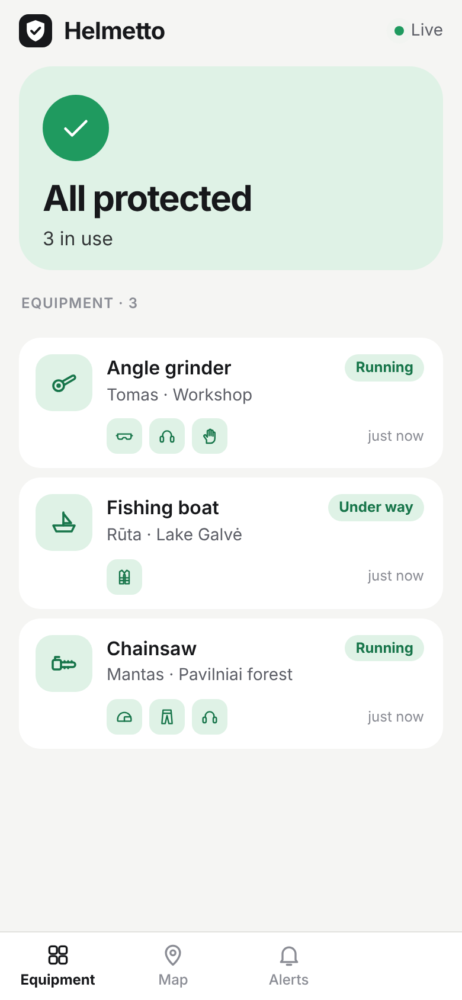
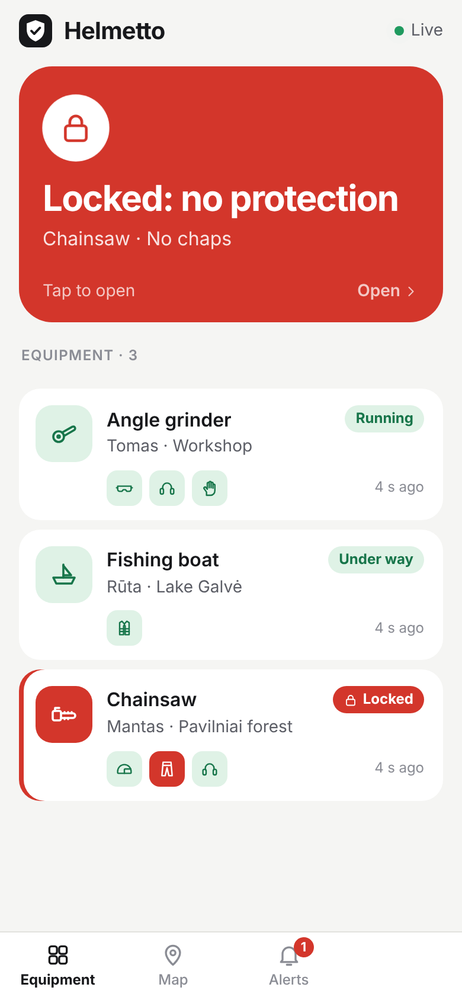
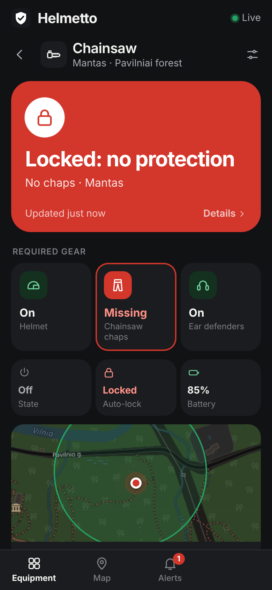

# Helmetto

Protective-gear check for dangerous equipment. A tag on the gear (safety
glasses, ear defenders, gloves, chainsaw chaps, helmet, life jacket) and a tag
on the equipment (angle grinder, chainsaw, boat). If the equipment is in use
and the required gear isn't there, the manager or owner gets an alert, and
the equipment can be locked until the gear is back.

Three use cases, one app:

| Use case | Equipment | Required gear (default) |
|---|---|---|
| Workshops | Angle grinder, saw, welder | Safety glasses, ear defenders, gloves |
| Forestry / arborists | Chainsaw | Helmet, chainsaw chaps, ear defenders (auto-lock) |
| Small boats / fishing | Boat or engine | Life jacket (must be worn) |

```
gear tag (ESP8266) --ESP-NOW heartbeat--> equipment tag (ESP8266) --HTTPS telemetry every 5 s--> api --SSE--> app
                                           scripts/simulate.ts --same HTTP endpoint----------^
```

| Folder | What |
|---|---|
| `web/` | The app: Vite + React + TypeScript, mobile-first PWA, Leaflet + OpenStreetMap |
| `api/` | Express + TypeScript, SQLite (`node:sqlite`), Server-Sent Events. Also serves the built web app |
| `ai/` | Safety rules as pure, unit-tested functions (transitions, offline timeout, geofence) |
| `shared/` | The contract: TypeScript types, route constants, **[`PROTOCOL.md`](shared/PROTOCOL.md)** |
| `scripts/` | `simulate.ts`: mock equipment that posts real telemetry |
| `infra/` | [`DEPLOY.md`](infra/DEPLOY.md) (Render / Railway) |

Hardware teammates only need [`shared/PROTOCOL.md`](shared/PROTOCOL.md): one
`POST` with a JSON body and an API key header, with curl and Arduino examples.

## Run locally

Needs Node 22.13 or newer.

```bash
npm install
```

```bash
npm run dev
```

- App: http://localhost:5173 (also on your LAN IP, for a phone on the same WiFi)
- API: http://localhost:3000

No `.env` is needed for local work: the API falls back to device `scooter-001`
(an angle grinder) with a dev-only key, and demo mode adds a simulated chainsaw
and boat. To choose your own, `cp .env.example .env` and edit it.

Or, in a second terminal, start a mock device (the angle grinder):

```bash
npm run simulate
```

```bash
npm run simulate -- --scenario gear-removed
```

Scenarios: `normal`, `gear-removed`, `gear-back`, `idle`, `crash`,
`geofence-exit`, `offline`. While the simulator runs, press `1`–`7` to
switch scenario and `q` to quit. `--minimal` sends only `helmet_connected` and
`crash_detected`, like today's hardware. Add `--device-id demo-chainsaw` etc.
only for devices whose key you know; the demo devices' keys are random per
server start, so drive them from the Demo panel instead. `npm run simulate -- --help`
lists all flags.

### Demo panel in the app

Tap the Helmetto logo five times (or open `/#demo`). It starts the same
simulator inside the server, one per device, so it works from a phone with no
laptop. **Start all** puts all three devices in normal use; then pick a device
and a scenario, e.g. Chainsaw → Gear taken off. Available
when the server runs with `DEMO_MODE=true` (the default locally).

### Other commands

| Command | What |
|---|---|
| `npm test` | Unit tests for `ai/` and integration tests for `api/` |
| `npm run typecheck` | TypeScript check for all packages |
| `npm run build` | Build the web app into `web/dist` |
| `npm start` | Production mode: API + built web app on one port |

## Screens

| All protected | Alert | Equipment (locked) | Alerts |
|---|---|---|---|
|  |  |  |  |

More in [`docs/screenshots/`](docs/screenshots), in light and dark mode.

- **Equipment** tab: one hero with the most urgent problem across all
  equipment (or "All protected"), then a card per piece of equipment with its
  state and a dot per required gear item. Tap a card for its page.
- **Equipment page**: the state, one tile per required gear item, auto-lock,
  battery, speed (boats), map. The sliders icon opens settings: name, who uses
  it, site, type, required gear, auto-lock.
- **Map** tab: pick a piece of equipment, see it live, draw its work area
  (tap corners, drag, tap **+** to add one) or use a circle.
- **Alerts** tab: what needs attention now across all equipment, and history.

## How the safety logic behaves

- The equipment posts telemetry every ~5 s. Fields the hardware can't measure
  yet are `null` and are shown as "Unknown" / "No tag", never as readings.
- **No protection** = the equipment is in use while a required gear tag is out
  of range or reports `worn: false`. Gear is not checked while the equipment
  is off, so putting the tool down and walking away is not an alert.
- **Auto-lock** (per device): while required gear is missing the server answers
  every telemetry post with `lock: true`; lock hardware on the tool keeps it
  from starting. The alert stays active while it is locked.
- Alerts fire on **state changes only**: no protection, impact, left the work
  area. Recoveries are logged too.
- No telemetry for 30 s → **offline**. The app then shows gear as unknown.
- The safe zone is either a shape drawn on the map (polygon, ray casting) or a
  circle (centre + radius, haversine). It is ignored when GPS is `null`, out of
  range or `0,0`.

## Deploy

One Node service on Render or Railway (not serverless: SSE and SQLite need a
persistent process). Full steps in [`infra/DEPLOY.md`](infra/DEPLOY.md); the
short version for Render is **New → Blueprint → this repo**, which reads
`render.yaml`.

## Known gaps (hackathon scope)

- **No login.** Anyone with the app URL can see the equipment and change its
  settings. Device telemetry is authenticated; the app API is not.
- Notifications work in-app and as browser notifications while the app is open.
  There is no web push, so nothing arrives when the app is fully closed.
- One hardware device is seeded from env vars (plus two simulated ones in demo
  mode). There is no UI or endpoint to add equipment yet.
- Locking is only a signal in the telemetry response: the current firmware
  doesn't act on it, and doesn't report `equipment_active` yet.
- On free hosting the SQLite file is wiped on redeploy.
